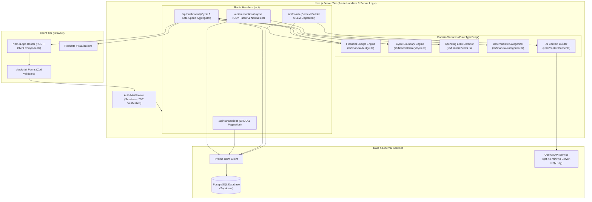
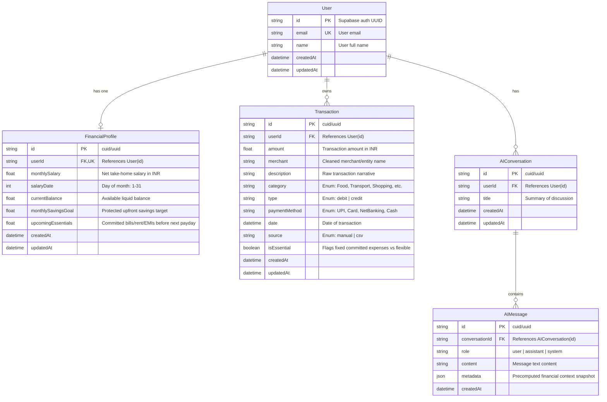
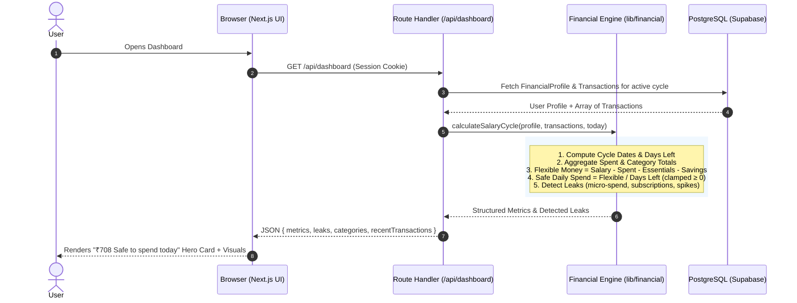
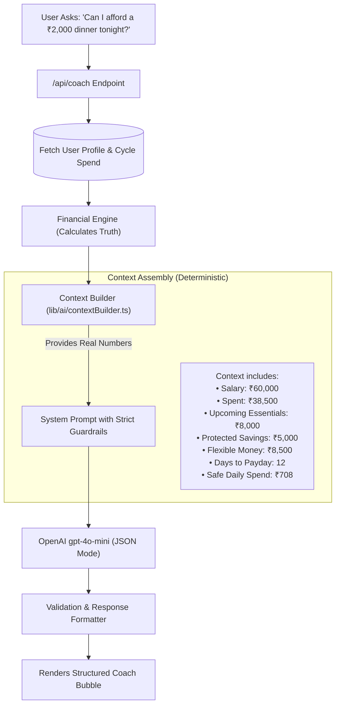

# Technical Architecture & System Design Document
## Salary-to-Salary Financial Coach (SpendWise)
**Document Version:** 1.0 (Hackathon MVP Architecture)  
**Role:** Senior Full-Stack Software Architect  
**Target Platform:** Web (Vercel + Supabase)  
**Date:** November 2026  

---

## A. Final Technology Stack

| Layer | Technology | Why We Use It | What Problem It Solves | Why It Is Appropriate For A Hackathon |
|---|---|---|---|---|
| **Framework** | **Next.js 14/15 (App Router)** | Full-stack unified TypeScript framework with React Server Components (RSC) and Server Actions/Route Handlers. | Eliminates the need for a separate backend repo/service; unifies frontend and backend type systems. | Zero configuration for API routing; one deployment target on Vercel; instant developer velocity. |
| **Language** | **TypeScript 5.x** | Static type safety end-to-end. | Prevents silent runtime math bugs, undefined balance errors, and schema drift across DB and client. | Self-documenting code; autocomplete speeds up team collaboration and avoids guessing object shapes. |
| **Styling & UI** | **Tailwind CSS + shadcn/ui + Lucide Icons** | Utility-first CSS coupled with copy-paste Radix-based accessible UI components. | Avoids reinventing dialogs, dropdowns, tables, cards, and form controls from scratch. | Modern, polished fintech SaaS appearance out of the box in minutes; easy customization without CSS bundle bloat. |
| **Charts** | **Recharts** | Declarative React charting library built on SVG. | Visualizes category distributions (Donut) and spending pace vs. target line. | Fast integration with responsive wrappers; lightweight; no canvas or heavy D3 configuration needed. |
| **Database** | **PostgreSQL (via Supabase)** | Enterprise-grade relational ACID database with built-in connection pooling and auth integration. | Reliably stores relational user profiles, salary cycles, and categorized transactions with transactional guarantees. | Managed cloud DB; spins up in 2 minutes; free tier is generous; native SQL console for debugging. |
| **ORM** | **Prisma ORM** | Type-safe database client and declarative schema migrations. | Eliminates handwritten SQL and runtime query typing mismatches; generates instant TypeScript client. | Fast schema prototyping (`prisma db push`), auto-generated types, built-in migration rollback protection. |
| **Authentication** | **Supabase Auth** | Turnkey email/password authentication with JWT-based sessions. | Handles password hashing, session tokens, refresh cycles, and user identities securely. | Native integration with Next.js middleware; eliminates writing custom auth controllers and token logic. |
| **AI / LLM** | **OpenAI API (`openai` SDK v4+)** | Official TypeScript SDK targeting `gpt-4o-mini`. | Contextual transaction categorization for ambiguous merchants; structured Q&A financial coaching. | `gpt-4o-mini` is ultra-fast (<1s latency), cost-effective (<$0.001/call), and supports strict JSON mode. |
| **Validation** | **Zod** | TypeScript-first schema declaration and validation. | Validates CSV rows, API payloads, and onboarding financial numbers at runtime. | Infers TypeScript types directly from schemas; zero code duplication between types and validation logic. |
| **CSV Parsing** | **Papaparse** | Proven browser- and Node-compatible CSV parser. | Robustly handles quoted strings, commas within merchant names, malformed lines, and streaming chunking. | Zero native dependencies; battle-tested across thousands of production apps. |
| **Deployment** | **Vercel** | Native serverless hosting platform for Next.js. | Automated CI/CD from GitHub, zero-downtime previews, environment variable management, and global edge CDN. | One-click deployment from git push; zero infrastructure maintenance during hackathon judging. |

---

## B. System Architecture Diagram



---

## C. Database ER Diagram

We use a normalized relational schema with an Enum for categories to avoid unnecessary JOIN overhead during high-frequency aggregations.



### Categorization Enum Definition:
`Food`, `Transport`, `Shopping`, `Bills`, `Entertainment`, `Subscriptions`, `Healthcare`, `Rent`, `Education`, `Travel`, `Groceries`, `Other`

---

## D. Data Flow Diagram



---

## E. API Architecture

All endpoints follow strict REST conventions, validate input via Zod, enforce Supabase authentication, and return predictable JSON shapes.

### Standard Response Envelope:
```typescript
interface ApiResponse<T> {
  success: boolean;
  data?: T;
  error?: {
    code: string;
    message: string;
    details?: unknown;
  };
}
```

### 1. `GET /api/dashboard`
* **Purpose**: Retrieves the unified financial cycle context, hero metrics, category totals, and detected leaks.
* **Auth**: Bearer token / Supabase session cookie.
* **Response `data`**:
  ```typescript
  {
    profile: { name: string; monthlySalary: number; salaryDate: number; };
    cycle: {
      cycleStart: string;
      nextPayday: string;
      daysInCycle: number;
      daysElapsed: number;
      daysUntilPayday: number;
    };
    budget: {
      monthlySalary: number;
      totalSpentThisCycle: number;
      upcomingEssentials: number;
      savingsGoal: number;
      flexibleMoney: number;
      safeDailySpend: number;
      burnRatePerDay: number;
      spentPercent: number;
      status: "healthy" | "watch" | "risk";
    };
    categoryBreakdown: Array<{ category: string; amount: number; percentage: number }>;
    leaks: Array<{ id: string; title: string; description: string; impact: string; severity: "low" | "medium" | "high" }>;
  }
  ```

### 2. `POST /api/transactions`
* **Purpose**: Creates a manual transaction.
* **Validation (Zod)**:
  ```typescript
  z.object({
    amount: z.number().positive(),
    description: z.string().min(1).max(200),
    merchant: z.string().optional(),
    category: z.enum([...categories]).optional(),
    paymentMethod: z.enum(["UPI", "Card", "NetBanking", "Cash"]).default("UPI"),
    date: z.string().datetime().or(z.string().regex(/^\d{4}-\d{2}-\d{2}$/)),
    isEssential: z.boolean().default(false)
  })
  ```
* **Status Codes**: `201 Created`, `400 Bad Request`, `401 Unauthorized`.

### 3. `GET /api/transactions`
* **Purpose**: Fetch paginated, filterable transactions.
* **Query Params**: `page=1`, `limit=20`, `category=Food`, `search=swiggy`, `cycle=current`.
* **Response**: `{ transactions: Transaction[], totalCount: number, page: number, totalPages: number }`.

### 4. `POST /api/transactions/import`
* **Purpose**: Batch import parsed and validated CSV rows.
* **Payload**: `{ transactions: Array<{ date: string; description: string; amount: number; category?: string; paymentMethod?: string }> }`.
* **Behavior**: Runs deterministic categorization on items without categories; executes a single `prisma.transaction.createMany` batch operation.
* **Response**: `{ importedCount: number; message: string }`.

### 5. `POST /api/coach`
* **Purpose**: Answers user financial queries with precomputed financial context.
* **Payload**:
  ```typescript
  z.object({
    question: z.string().min(2).max(500),
    conversationId: z.string().optional()
  })
  ```
* **Response**:
  ```typescript
  {
    answer: string;
    affordability?: "yes" | "yes_with_caution" | "no";
    impactAnalysis?: string;
    recommendation: string;
  }
  ```

---

## F. AI Architecture & Guardrails

The application strictly enforces that the LLM is **an interpreter and narrator, not an arithmetic engine**.



### 1. System Prompt Guardrails
```text
You are SpendWise AI, a pragmatic financial coach for salaried Indian professionals.
You will be provided with pre-computed, verified financial data.

CRITICAL RULES:
1. NEVER calculate new balances, totals, or safe daily spending. Use ONLY the numbers provided in the context.
2. If asked about a purchase:
   - Compare purchase amount with Flexible Money.
   - If Purchase > Flexible Money: verdict is "no" (it violates savings or essential commitments).
   - If Purchase ≤ Flexible Money but > 20% of Flexible Money: verdict is "yes_with_caution".
   - If Purchase is modest (≤ 20% of Flexible Money): verdict is "yes".
3. All amounts are in Indian Rupees (₹).
4. Always give exactly ONE practical next step.
5. You are not a licensed SEBI advisor. Never advise on stocks, crypto, or loans.
```

### 2. Ambiguous Transaction Categorizer
If a CSV or manual entry cannot be matched by our 100+ keyword dictionary:
* Input: `{"description": "MSFT *AZURE 34912 BLR"}`
* Prompt: Classify into one of: `[Food, Transport, Shopping, Bills, Subscriptions, Healthcare, Rent, Education, Travel, Groceries, Other]`.
* Output: `{"category": "Bills", "confidence": 0.95}`.

---

## G. Project Folder Structure

A production-ready Next.js App Router structure optimized for rapid hackathon iteration:

```text
spenzbuddy/
├── .env.example
├── README.md
├── REQUIREMENTS.md
├── package.json
├── tsconfig.json
├── tailwind.config.ts
├── prisma/
│   ├── schema.prisma           # Prisma models & enums
│   └── seed.ts                 # Demo seed (Rahul - ₹60k salary benchmark)
│
├── src/
│   ├── app/
│   │   ├── layout.tsx          # Root layout (Tailwind, Inter font, Toaster)
│   │   ├── page.tsx            # Marketing Landing Page (Hero, ₹708 concept)
│   │   ├── login/page.tsx      # Supabase Auth Login & Signup
│   │   ├── onboarding/page.tsx # Salary, Payday, Savings Goal wizard
│   │   ├── dashboard/page.tsx  # Core Hero card, 6 stats, charts, leaks
│   │   ├── transactions/
│   │   │   └── page.tsx        # Ledger, manual add modal, CSV import dialog
│   │   ├── insights/page.tsx   # Detailed category breakdown & spending pace
│   │   ├── coach/page.tsx      # Full-page AI Coach conversation view
│   │   └── api/
│   │       ├── dashboard/route.ts
│   │       ├── transactions/
│   │       │   ├── route.ts
│   │       │   └── import/route.ts
│   │       ├── coach/route.ts
│   │       └── seed/route.ts   # 1-click hackathon demo seed trigger
│   │
│   ├── components/
│   │   ├── ui/                 # Reusable shadcn/ui components (button, card, dialog, input, etc.)
│   │   ├── layout/             # Navbar, Sidebar, Footer, MobileNav
│   │   ├── dashboard/          # HeroSafeSpendCard, FormulaDrawer, StatGrid, PaceBar
│   │   ├── transactions/       # TransactionTable, ManualAddModal, CsvDropzone
│   │   ├── insights/           # CategoryPieChart, DailyPaceChart, LeakCards
│   │   └── coach/              # CoachChatBox, SuggestedChips, AffordabilityBadge
│   │
│   ├── lib/
│   │   ├── auth/               # Supabase browser & server clients, session helpers
│   │   ├── db/                 # Prisma client singleton (prisma.ts)
│   │   ├── financial/          # DETERMINISTIC FINANCIAL LAYER
│   │   │   ├── salaryCycle.ts  # Payday dates, days remaining, leap years
│   │   │   ├── budget.ts       # Flexible money, safe daily spend, burn rate
│   │   │   ├── categorizer.ts  # Keyword dictionary matching (100+ Indian merchants)
│   │   │   └── leaks.ts        # Micro-expense, subscription, and spike detectors
│   │   ├── csv/                # Papaparse wrapper, column normalizer, date sanitizer
│   │   └── ai/                 # OpenAI client, contextBuilder.ts, coachPrompts.ts
│   │
│   ├── types/
│   │   ├── financial.ts        # BudgetMetrics, SalaryCycle, LeakItem interfaces
│   │   └── transaction.ts      # Transaction, Category, Import types
│   │
│   └── hooks/
│       ├── useDashboard.ts     # SWR/Fetch hook for dashboard metrics
│       └── useTransactions.ts  # Optimistic mutations for transactions
```

---

## H. Security Architecture

1. **Server-Side API Key Isolation**:
   * `OPENAI_API_KEY`, `DATABASE_URL`, `DIRECT_URL`, and `SUPABASE_SERVICE_ROLE_KEY` are strictly accessible on the server. Never prefixed with `NEXT_PUBLIC_`.
2. **User Data Isolation (Tenant Boundaries)**:
   * Every Prisma query strictly includes `where: { userId: session.user.id }`.
   * Cross-user query tampering is blocked at both the route handler layer and Supabase PostgreSQL Row Level Security (RLS).
3. **Input Sanitization & Injection Defense**:
   * All API requests validated with **Zod**; unrecognized fields are stripped.
   * Prisma uses parameterized queries, eliminating SQL injection.
   * CSV contents are parsed in memory; no shell executions or temp-file storage.
4. **CSV File Protection**:
   * Maximum file size limited to **2 MB**.
   * MIME type validated to `text/csv`, `application/vnd.ms-excel`, or `.csv` extension.
   * Maximum row limit capped at **500 rows** per upload to prevent serverless execution timeouts.
5. **Session Management**:
   * Handled via HTTP-only, secure, SameSite cookies managed by `@supabase/ssr`.

---

## I. CSV Processing Flow

```mermaid
flowchart TD
    A[User drops .csv file in UI] --> B[Client validates: Size ≤ 2MB, .csv extension]
    B --> C[PapaParse parses headers & rows into raw objects]
    C --> D[Column Header Normalizer: Matches 'amount|debit|rs', 'date|txn_date', 'desc|narration|merchant']
    D --> E[Row Validation: Drop empty rows, parse positive float amount, parse ISO date]
    E --> F[Preview Dialog: Shows first 5 valid rows + invalid error count]
    F -->|User clicks Confirm Import| G[POST /api/transactions/import]
    G --> H[Server Rule Engine: Auto-categorize via Keyword Dictionary]
    H --> I[AI Categorization Fallback: Only for remaining unclassified items]
    I --> J[Prisma createMany: Batch insert under current userId]
    J --> K[Trigger Budget Recalculation]
    K --> L[Client UI updates dashboard instantly]
```

---

## J. Financial Calculation Flow (The Deterministic Core)

This core module contains zero floating-point ambiguities and is isolated in `src/lib/financial/budget.ts`:

```typescript
// 1. Inputs from Profile and Ledger
const S = profile.monthlySalary;          // e.g. ₹60,000
const E_spent = totalSpentInCycle;         // e.g. ₹38,500
const E_essentials = profile.upcomingEssentials; // e.g. ₹8,000
const S_goal = profile.monthlySavingsGoal; // e.g. ₹5,000
const D_rem = Math.max(1, daysUntilPayday); // e.g. 12

// 2. Flexible Money
const flexibleMoney = S - E_spent - E_essentials - S_goal; // ₹8,500

// 3. Safe Daily Spend (Floor to integer Rupee, clamp to zero)
const safeDailySpend = flexibleMoney > 0 ? Math.floor(flexibleMoney / D_rem) : 0; // ₹708

// 4. Burn Rate Per Day
const burnRatePerDay = daysElapsed > 0 ? Math.round(E_spent / daysElapsed) : 0;

// 5. Pace & Health Status
const budgetUsageRatio = (E_spent / (S - E_essentials - S_goal));
const cycleTimeRatio = (daysElapsed / totalDaysInCycle);
const paceRatio = budgetUsageRatio / Math.max(0.01, cycleTimeRatio);

let status: "healthy" | "watch" | "risk" = "healthy";
if (flexibleMoney <= 0 || paceRatio > 1.25) {
  status = "risk";
} else if (paceRatio > 1.0) {
  status = "watch";
}
```

---

## K. AI Request / Response Contract

### Input Context Payload sent to OpenAI:
```json
{
  "financialSnapshot": {
    "monthlySalary": 60000,
    "spentThisCycle": 38500,
    "upcomingEssentials": 8000,
    "savingsGoal": 5000,
    "flexibleMoneyRemaining": 8500,
    "daysUntilPayday": 12,
    "safeDailySpend": 708,
    "burnRatePerDay": 2138,
    "budgetStatus": "watch",
    "topCategories": [
      { "category": "Food", "amount": 12400 },
      { "category": "Shopping", "amount": 8200 },
      { "category": "Transport", "amount": 3400 }
    ],
    "activeLeaks": [
      "17 small purchases under ₹100 added up to ₹1,850",
      "Food spending is 38% higher than usual"
    ]
  },
  "userQuestion": "Can I afford a ₹2,000 purchase today?"
}
```

### Expected Structured JSON Output from Model:
```json
{
  "affordability": "yes_with_caution",
  "answer": "You can afford the ₹2,000 purchase, but it will consume about 24% of your remaining ₹8,500 flexible budget. With 12 days left until payday, your safe daily spend will drop from ₹708 to ₹541.",
  "impactAnalysis": "Reduces remaining flexible money to ₹6,500. Drops daily safe spend by ₹167/day.",
  "recommendation": "If you make this purchase, limit your food and discretionary spend to under ₹500 for the next 3 days to stay on track for your ₹5,000 savings goal."
}
```

---

## L. Development Phases & Implementation Milestones

```mermaid
gantt
    title SpendWise Incremental Build Plan (Hackathon Timeline)
    dateFormat  X
    axisFormat  Day %d
    
    section Foundation
    Phase 1: Project Setup & Config    :active, p1, 0, 1
    Phase 2: Database & Prisma Schema  :p2, 1, 2
    Phase 3: Supabase Auth & Onboarding:p3, 2, 3
    
    section Core Financials
    Phase 4: Deterministic Budget Engine:p4, 3, 4
    Phase 5: Core Dashboard & Hero Card:p5, 4, 5
    Phase 6: Transaction Ledger & CRUD :p6, 5, 6
    
    section Ingestion & Intelligence
    Phase 7: CSV Upload & Normalizer   :p7, 6, 7
    Phase 8: Spending Leak Heuristics  :p8, 7, 8
    Phase 9: AI Financial Coach API    :p9, 8, 9
    
    section Polish & Launch
    Phase 10: Demo Data & E2E Testing  :p10, 9, 10
    Phase 11: Deployment & Verification:p11, 10, 11
```

### Phase 1: Project Setup & Configuration
* **Goal**: Initialize Next.js project with Tailwind CSS, Lucide icons, and `.env.example`.
* **Files**: `package.json`, `tsconfig.json`, `tailwind.config.ts`, `.env.example`, `src/app/layout.tsx`.
* **Dependencies**: `next`, `react`, `tailwindcss`, `lucide-react`, `clsx`, `tailwind-merge`.
* **Expected Output**: Clean running Next.js app on `localhost:3000`.
* **Test**: Run `npm run dev` and verify clean rendering.
* **Definition of Done (DoD)**: Linter passes with 0 warnings.

### Phase 2: Database & Prisma Schema
* **Goal**: Define PostgreSQL schema for Users, FinancialProfile, and Transactions.
* **Files**: `prisma/schema.prisma`, `src/lib/db/prisma.ts`.
* **Dependencies**: `@prisma/client`, `prisma`.
* **Expected Output**: Prisma client generated; migrations ready to push.
* **Test**: Run `npx prisma db push` and verify tables in Supabase Studio.
* **DoD**: Schema compiles with all relations and indexes.

### Phase 3: Supabase Auth & Onboarding Flow
* **Goal**: Enable user signup, login, and initial salary/budget profile configuration.
* **Files**: `src/app/login/page.tsx`, `src/app/onboarding/page.tsx`, `src/lib/auth/supabase.ts`, `src/middleware.ts`.
* **Dependencies**: `@supabase/ssr`, `@supabase/supabase-js`.
* **Expected Output**: A user can register, fill in their ₹60,000 salary profile, and be saved to the database.
* **Test**: Complete a sign-up and verify profile row in PostgreSQL.
* **DoD**: Unauthenticated requests to `/dashboard` redirect to `/login`.

### Phase 4: Deterministic Budget Engine
* **Goal**: Build pure TypeScript functions calculating cycle dates, flexible money, and safe daily spend.
* **Files**: `src/lib/financial/salaryCycle.ts`, `src/lib/financial/budget.ts`, `src/types/financial.ts`.
* **Dependencies**: `date-fns` (or native JS date arithmetic).
* **Expected Output**: Standalone testable functions yielding exact values (e.g. ₹708 for Rahul benchmark).
* **Test**: Write automated unit tests verifying standard values, leap years, and negative flexible money clamps.
* **DoD**: 100% of arithmetic test assertions pass.

### Phase 5: Core Dashboard & Hero Safe-Spend Card
* **Goal**: Build the primary user interface showcasing "₹708 Safe to spend today" with expandable formula breakdown.
* **Files**: `src/app/dashboard/page.tsx`, `src/components/dashboard/HeroSafeSpendCard.tsx`, `src/components/dashboard/StatCards.tsx`.
* **Dependencies**: `recharts`, `framer-motion` (subtle fade-in).
* **Expected Output**: Polished fintech dashboard with 6 stat cards and salary cycle countdown.
* **Test**: Load dashboard with seeded data and verify cards reflect database state.
* **DoD**: Visual hierarchy matches fintech design standards; mobile responsive.

### Phase 6: Transaction Ledger & CRUD
* **Goal**: Allow users to view and manually log new transactions with instant recalculation.
* **Files**: `src/app/transactions/page.tsx`, `src/components/transactions/TransactionTable.tsx`, `src/components/transactions/AddTransactionModal.tsx`, `src/app/api/transactions/route.ts`.
* **Dependencies**: `zod`, `react-hook-form`.
* **Expected Output**: Add a ₹500 Swiggy expense and watch safe daily spend drop immediately.
* **Test**: Add, edit, and delete an expense; verify DB and UI update.
* **DoD**: Instant optimistic UI update without full page reload.

### Phase 7: CSV Upload & Normalizer
* **Goal**: Enable uploading standard bank/card CSV files with column mapping and deduplication.
* **Files**: `src/components/transactions/CsvDropzone.tsx`, `src/lib/csv/parser.ts`, `src/app/api/transactions/import/route.ts`.
* **Dependencies**: `papaparse`.
* **Expected Output**: Drag-and-drop a sample CSV, preview 5 rows, and batch-import into the ledger.
* **Test**: Upload `sample-transactions.csv` and verify all rows are inserted and categorized.
* **DoD**: Corrupted CSVs fail gracefully with user-friendly error toast.

### Phase 8: Spending Leak Heuristics
* **Goal**: Implement deterministic leak detection for micro-expenses, subscriptions, and category velocity spikes.
* **Files**: `src/lib/financial/leaks.ts`, `src/components/insights/LeakCards.tsx`, `src/app/insights/page.tsx`.
* **Expected Output**: Generates at least 3 actionable leak alerts from benchmark data.
* **Test**: Verify micro-spend rule triggers when 15+ purchases under ₹100 exist.
* **DoD**: Each leak displays exact INR impact and an actionable recommendation.

### Phase 9: AI Financial Coach API & Chat Interface
* **Goal**: Safe, context-bounded conversational AI answering questions like "Can I afford a ₹2,000 purchase?".
* **Files**: `src/lib/ai/contextBuilder.ts`, `src/app/api/coach/route.ts`, `src/components/coach/CoachChatBox.tsx`, `src/app/coach/page.tsx`.
* **Dependencies**: `openai`.
* **Expected Output**: Instant structured recommendation referencing actual flexible budget.
* **Test**: Query "Can I afford ₹2,000?" and verify answer mentions ₹8,500 flexible balance and new ₹541 safe spend.
* **DoD**: Model never hallucinates non-existent numbers; responds in under 2 seconds.

### Phase 10: Demo Data & End-to-End Testing
* **Goal**: Create 1-click demo button that seeds "Rahul" (₹60k salary, ₹708 safe daily spend).
* **Files**: `prisma/seed.ts`, `sample-transactions.csv`, `src/app/api/seed/route.ts`.
* **Expected Output**: Evaluator can click "Load Demo Profile" and test the full application immediately.
* **Test**: Complete entire journey (Landing → Demo Login → Dashboard → Add Expense → CSV Import → AI Coach).
* **DoD**: Complete demo runs cleanly with zero console errors.

### Phase 11: Deployment & Production Verification
* **Goal**: Deploy to Vercel, link Supabase PostgreSQL, set up production environment variables.
* **Files**: `README.md`, Vercel project configuration.
* **Expected Output**: Live public URL with SSL and automated CI/CD.
* **Test**: Test full application flow on mobile browser over live URL.
* **DoD**: Green build status on Vercel; README contains clear setup and demo guide.

---

## M. Recommended npm Packages (Lean, Zero Bloat)

We strictly avoid unnecessary libraries (no heavy Redux, no huge Lodash, no redundant date libraries).

```json
{
  "dependencies": {
    "next": "^14.2.0",
    "react": "^18.3.0",
    "react-dom": "^18.3.0",
    "typescript": "^5.4.0",
    "@prisma/client": "^5.14.0",
    "@supabase/supabase-js": "^2.43.0",
    "@supabase/ssr": "^0.3.0",
    "openai": "^4.50.0",
    "zod": "^3.23.0",
    "papaparse": "^5.4.1",
    "@types/papaparse": "^5.3.14",
    "recharts": "^2.12.0",
    "lucide-react": "^0.378.0",
    "clsx": "^2.1.1",
    "tailwind-merge": "^2.3.0",
    "date-fns": "^3.6.0"
  },
  "devDependencies": {
    "prisma": "^5.14.0",
    "tailwindcss": "^3.4.1",
    "postcss": "^8.4.38",
    "autoprefixer": "^10.4.19",
    "@types/node": "^20.12.0",
    "@types/react": "^18.3.0"
  }
}
```

---

## N. Risks, Technical Trade-Offs & Mitigations

| Risk / Trade-Off | Likely Impact | Architectural Mitigation |
|---|---|---|
| **1. AI Hallucination on Financial Math** | High (Critical trust failure if AI invents balances). | **Strict Context Injection**: The LLM never receives a raw prompt to calculate numbers. It receives precomputed totals and a system prompt forbidding independent math. |
| **2. CSV Header Variations Across Indian Banks** | Medium (User's HDFC/ICICI CSV has columns named `Txn Date`, `Dr Amount`, etc.). | **Fuzzy Header Normalizer**: Match aliases (`['date', 'txn date', 'transaction date', 'value date']` $\rightarrow$ `date`). Provide a preview step where users confirm column assignments if unmapped. |
| **3. Mid-Cycle & Irregular Salary Days (31st)** | Medium (Payday falls on 31st during 30-day or 28-day months). | **Date Snapping Utility**: In `salaryCycle.ts`, clamp target day to `Math.min(salaryDate, lastDayOfMonth)`. |
| **4. Negative Flexible Money (Deficit Spending)** | Medium (User overspends, resulting in negative safe-spend). | **Deficit Clamp**: Clamp `safeDailySpend = Math.max(0, ...)`. Switch UI to a high-contrast Red "Budget Deficit" alert showing how much savings is being eaten into. |
| **5. Database Cold Starts & Connection Limits** | Low-Medium (Serverless functions exhausting Postgres pool). | Use **Supabase Transaction Pooler (Port 6543 with PgBouncer)** in `DATABASE_URL` and direct connection for migrations in `DIRECT_URL`. |
| **6. Offline / Zero-Key Demo Dependency** | High (Hackathon evaluator tests app without configuring OpenAI or Supabase keys). | **In-Memory Demo Mock Mode**: Provide fallback mock data and simulated AI responses in demo mode so the application runs 100% reliably even without live external API keys. |

---
*Architecture document generated and saved to `ARCHITECTURE.md`. Ready for phased review and implementation.*
